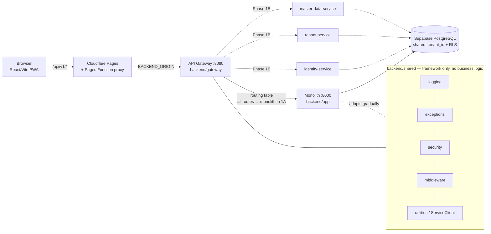

# Grobook 360 — Phase 1A architecture

Status: **Phase 1A (foundation).** The FastAPI monolith still serves 100% of the API. Nothing has been extracted yet.

## Topology

Solid = exists and tested today. Dashed = Phase 1B or later.

## What Phase 1A added

| Component | Path | Purpose |
|---|---|---|
| API Gateway | `backend/gateway/` | Single entry point; routing, correlation id, optional JWT verification + tenant header, rate-limit foundation, standard errors, JSON access log |
| Shared kit | `backend/shared/` | Logging (with secret redaction), error envelope, JWT verification, correlation middleware, `ServiceClient` (timeouts, safe retries) |
| Event contracts | `events/schemas/` | Envelope + 5 versioned event schemas; Outbox design in `events/contracts/` |
| Schema ownership map | `database/documentation/` | Which service will own each of the 63 tables (documentation only) |
| Local topology | `docker-compose.yml` | gateway + monolith against Supabase |
| CI | `.github/workflows/ci.yml` | gateway/shared tests, monolith tests, frontend build |

## Design decisions

1. **Gateway is a pure proxy.** It never parses business payloads. All existing URLs, cookies and error bodies are preserved, so the frontend needs no change (it can keep calling the Pages Function; only `BACKEND_ORIGIN` would change when the gateway is deployed).
2. **`AUTH_MODE=passthrough` by default.** The monolith's session check (including DB revocation) stays the only authority. `verify` mode is opt-in because a signature check alone cannot see logout/revocation.
3. **Identity is derived, never accepted.** `X-Tenant-Id`/`X-User-Id`/`X-User-Role` from clients are always stripped; in verify mode they are re-added from the signed token.
4. **No new infrastructure.** No broker, no service mesh, no Redis. Events are contracts + a documented Outbox for later.
5. **Sales / Inventory / Accounting / GST stay inside one transaction** (see `docs/architecture/transactional-boundary.md`).
6. **Honest scope.** No empty service skeletons were generated. Services appear in Phase 1B when they have real code.

## Not done in Phase 1A (by instruction)
- No table moved between schemas; no migration written.
- No service extracted (Phase 1B, awaiting approval).
- Nothing deployed.

## Pending verification (not yet tested — do not treat as done)
- Docker image builds (`backend/Dockerfile`, `backend/gateway/Dockerfile`) and `docker-compose.yml`: Docker was not available on the dev machine.
- GitHub Actions workflow `.github/workflows/ci.yml`: never executed.
- `X-Forwarded-For` end-to-end (gateway → monolith → per-IP login/sign-up limits): not tested.
- Gateway deployed behind Cloudflare Tunnel/Pages: not tested.
